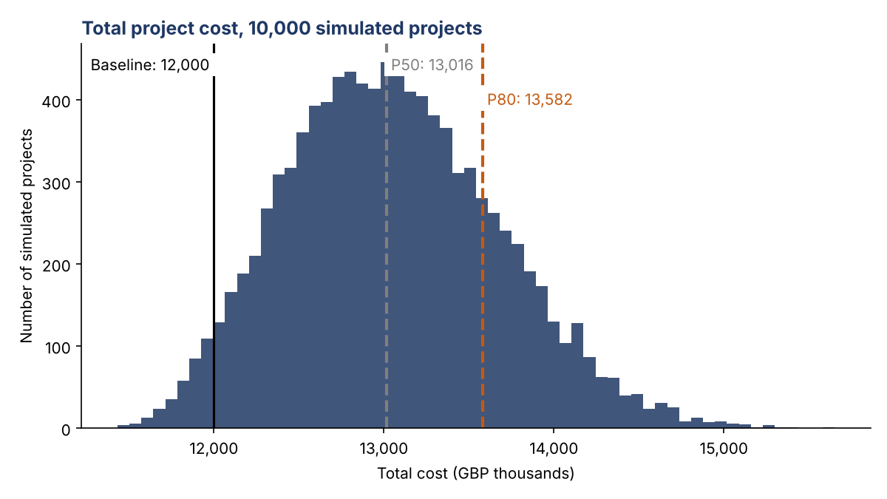
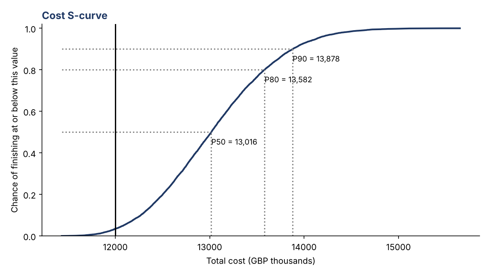
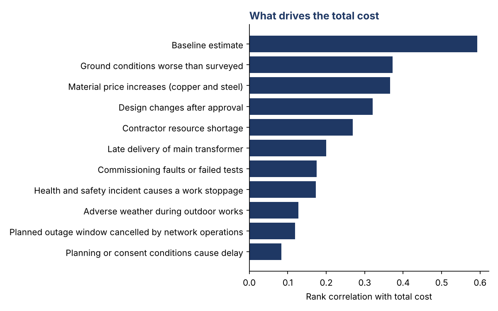
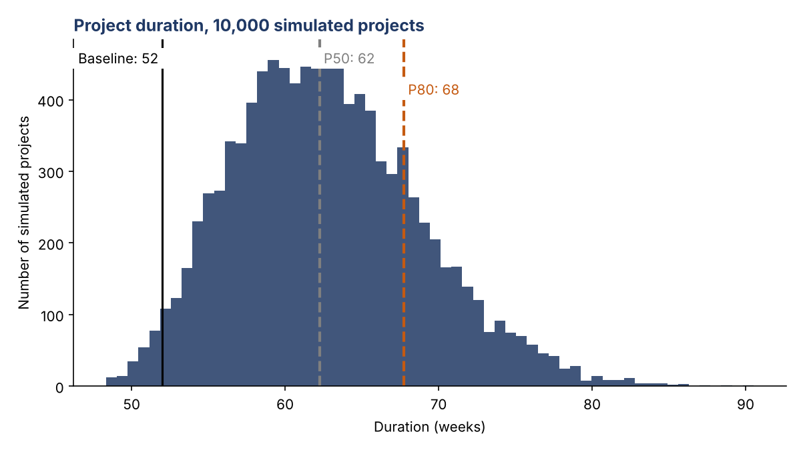

# Project Risk Monte Carlo Simulation

A learning project that shows how a **quantitative cost and schedule risk analysis (QCRA / QSRA)** works, using a Monte Carlo simulation in Python and Excel.

> **Everything here is fictional.** The project (the *Eastvale 33kV Substation Upgrade*), the company (*Northvale Grid Services*) and every number are invented for learning. This is not a real analysis of any real project.

## The question

A project has a baseline estimate of **£12.0m** and **52 weeks**, and a risk register of ten risks. How much contingency should the project hold so there is a good chance of finishing on budget and on time?

A single "best guess" hides the uncertainty. Instead, the simulation runs the project **10,000 times**. In each run every risk either happens or not (using its probability). If it happens, its cost and delay are drawn from a **triangular distribution** (minimum, most likely, maximum). Adding up all 10,000 outcomes gives a range of results and percentiles such as **P50** and **P80**.

## Results (10,000 runs, seed 42)

| Measure | Baseline | Mean | P50 | P80 | P90 | Contingency at P80 | Chance of finishing within baseline |
|---|---|---|---|---|---|---|---|
| Total cost (£ thousands) | 12,000 | 13,049 | 13,016 | 13,582 | 13,878 | 1,582 | 3.5% |
| Total duration (weeks) | 52 | 62.7 | 62.3 | 67.8 | 70.9 | 15.8 | 2.1% |

**Reading this:** with no contingency, the chance of finishing within the £12.0m baseline is only about 4%. Holding a P80 contingency of roughly **£1.6m** (13% of the baseline) gives an 80% chance of finishing within budget.









## What is in this repository

| Path | What it is |
|---|---|
| `data/risk_register.csv` | The ten invented risks, with probabilities and three-point cost and delay estimates |
| `src/simulate.py` | The simulation, percentile table, sensitivity ranking and charts |
| `notebooks/project_risk_monte_carlo.ipynb` | Step-by-step walkthrough with explanations and results |
| `excel/Project_Risk_Monte_Carlo.xlsx` | The same model with live Excel formulas (1,000 runs). Press F9 to re-run |
| `outputs/` | Charts and result tables created by the script |

## How to run it

```bash
pip install -r requirements.txt
python src/simulate.py
```

This prints the results and rewrites the charts and tables in `outputs/`. To explore step by step, open the notebook:

```bash
jupyter notebook notebooks/project_risk_monte_carlo.ipynb
```

To change the scenario, edit `data/risk_register.csv` (probabilities and ranges) or the constants at the top of `src/simulate.py`.

## Method in brief

1. **Risk register:** each risk has a probability, a cost range and a delay range.
2. **Sampling:** a risk happens if a random number is below its probability. If it happens, a random number is turned into a cost and a delay using the inverse of the triangular distribution. One random draw is used for both, so a very bad outcome is bad for cost and time.
3. **Baseline uncertainty:** the baseline cost and duration also have a range, because estimates are never exact.
4. **Totals:** cost is the baseline plus all risk costs. Duration is the baseline plus 60% of the summed delays (some work runs in parallel).
5. **Outputs:** percentiles, an S-curve, and a ranking of which risks move the total cost most (rank correlation).

## Limitations

- All inputs are invented. A real analysis uses the project's own risk register and estimates agreed with the project team.
- Risks are treated as **independent**. In real projects one risk often makes another more likely.
- The schedule is **not** modelled on a real programme network. A fixed 60% of each delay is assumed to reach the critical path. A real QSRA uses the project schedule.
- Triangular distributions are used for simplicity. PERT and lognormal are common alternatives.
- Only risks in the register are included. Unknown unknowns are not.
- The Excel version uses 1,000 runs and different random numbers each time, so its results differ slightly from the Python version.

## Skills shown

Python (numpy, pandas, matplotlib), Monte Carlo simulation, probability distributions, percentile-based contingency (P50 / P80 / P90), sensitivity analysis, risk registers, and Excel modelling with formulas.

## Author

Torome Caleb Saitoti, BSc Actuarial Science, MSc Information Technology with Data Analytics.
[LinkedIn](https://linkedin.com/in/torome-saitoti-dataanalyst) | [GitHub](https://github.com/Kayleb-tech)

## Licence

MIT. See `LICENSE`.
